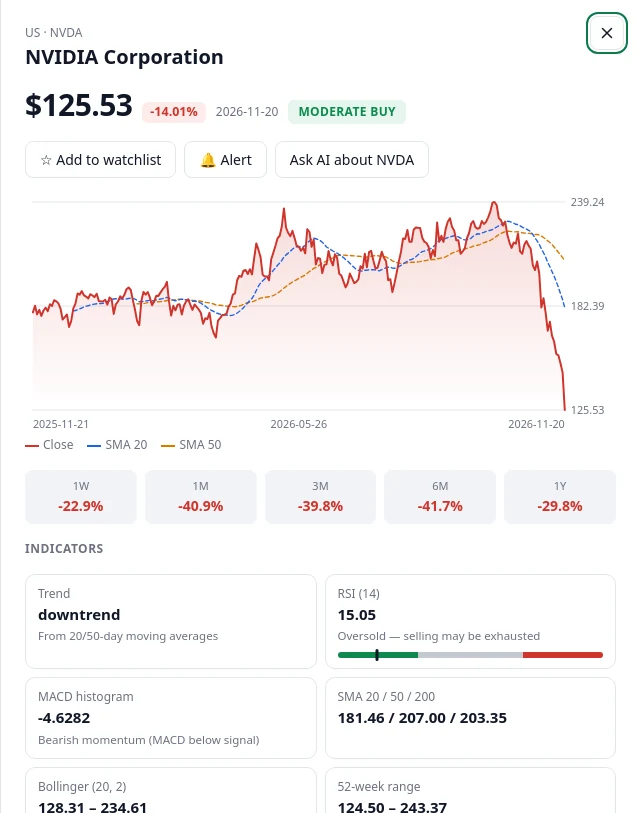

<div align="center">


# nVestPadi

**An open-source AI research desk for Nigerian (NGX) and US stocks.**

Daily market sync · technical analysis · screener · alerts · AI answers that cite their sources

[](https://github.com/oluwaeinstein007/nVestPadi/actions/workflows/ci.yml)
[](LICENSE)


[Quick start](#quick-start) · [Features](#features) · [CLI](#cli) · [API](#rest-api) · [Deploy](#deploy) · [Architecture](docs/architecture.md)

<br />

<picture>
  <source media="(prefers-color-scheme: dark)" srcset="public/img/dashboard-dark.webp" />
  
</picture>

</div>

---

## Why nVestPadi?

Researching Nigerian stocks usually means juggling the NGX website, broker PDFs, spreadsheets and WhatsApp groups. nVestPadi puts it in one place:

- **Market data built in.** It pulls the full NGX daily board (about 150 equities) and any US tickers. You don't need a data subscription or API keys.
- **Analysis you can read.** Every stock gets a technical report in plain English, not just a chart.
- **Alerts where you already are.** It pings Telegram or Discord when a price, RSI or volume condition hits.
- **AI that shows its work.** Ask a question and the answer cites the market data and documents it used. It's instructed never to invent figures.
- **Yours to run.** It runs on your laptop or a $5 server. Your watchlist and research never leave it.

## Features

| | |
|---|---|
| 📊 **Market breadth** | Advancers vs decliners, value traded, top gainers and losers, the most traded stocks, and every sector ranked by its move |
| 📈 **Technical reports** | Trend, RSI, MACD, SMA 20/50/200, Bollinger Bands, ATR, volatility, 52-week range, 1W–1Y performance and BUY/SELL signals with reasons |
| 🔎 **Screener** | Filter by sector, name, price and RSI (e.g. *oversold banks*); sort by gainers, losers, value, volume or RSI |
| ⭐ **Watchlist** | Track NGX and US symbols side by side with sparklines |
| 🔔 **Alerts** | `above`, `below`, `change-above`, `change-below`, `rsi-above`, `rsi-below`, `volume-spike`, delivered to Telegram and/or Discord |
| 💬 **Ask AI** | Answers grounded in live reports, market breadth and your ingested research, with numbered citations |
| 📄 **Research ingestion** | Annual-report PDFs, HTML, CSV, JSON, Markdown, or whole websites (robots.txt-aware); unchanged content is never re-embedded |
| 🖥️ **Web app + CLI** | Responsive light/dark dashboard, a landing page, a REST API and a scriptable `nvest` CLI (`--json` everywhere) |
| ⏱️ **Automation** | `--sync-every 60` keeps data fresh and checks alerts on a schedule |

<table>
  <tr>
    <td width="50%">
      <picture>
        <source media="(prefers-color-scheme: dark)" srcset="public/img/detail-dark.webp" />
        
      </picture>
    </td>
    <td>
      <b>From ticker to thesis in one click</b><br /><br />
      Open any stock for an interactive chart with SMA overlays, a BUY/SELL signal with its reasoning, performance from 1W to 1Y, and indicator cards that explain what each number means.<br /><br />
      Links are shareable, e.g. <code>/app#NGX:GTCO</code>.
    </td>
  </tr>
</table>

## Quick start

Requires **Node.js ≥ 22.13** and **pnpm**.

```bash
git clone https://github.com/oluwaeinstein007/nVestPadi
cd nVestPadi && pnpm install

pnpm nvest sync            # today's NGX + US prices
pnpm nvest market          # breadth, movers, sectors
pnpm nvest analyze DANGCEM # technical report
pnpm nvest serve           # landing → http://127.0.0.1:3000, dashboard → /app
```

No `.env` is needed for any of the above. Run `pnpm nvest doctor` at any time to check your setup.

```text
$ pnpm nvest market

NGX market  session 2026-11-20
  ▲ 17  ▼ 39  ■ 90   volume 305.6M   value 16.5B

Top gainers
  Symbol     Name                          Price   Change  Value
  MAYBAKER   May & Baker Nigeria           44.00  +10.00%  65.6M
  CORNERST   Cornerstone Insurance Compan   5.00   +9.89%  17.4M
```

### Turn on AI (optional)

```bash
cp .env.example .env
```

```ini
AI_PROVIDER=gemini                 # or openai
AI_API_KEY=your-key
QDRANT_URL=http://localhost:6333   # docker run -p 6333:6333 qdrant/qdrant
```

```bash
pnpm nvest ingest file ./reports/gtco-2025-annual.pdf
pnpm nvest ask "How did Nigerian banks trade this week?"
```

`ask` works without Qdrant too. It then answers from market data alone. Qdrant adds your documents and semantic `search`.

## CLI

`nvest <command> [options]`. Every command supports `--json` and `--verbose`. Run `nvest help <command>` for details.

| Command | Description |
|---|---|
| `sync [ngx\|us\|all]` | Fetch the latest session, store it, index it and check alerts. `--symbols A,B` `--no-index` `--every MIN` |
| `history <SYM>` | Backfill daily history. `--exchange` `--range 1mo…max` |
| `quote <SYM...>` | Latest stored quotes |
| `analyze <SYM>` | Full technical report |
| `market` | Breadth, movers, sectors. `--exchange NGX\|US` `--top N` |
| `screen` | Screener. `--sector` `--search` `--sort` `--min-price` `--max-price` `--rsi-below` `--rsi-above` `--limit` |
| `watchlist [list\|add\|remove]` | Manage your watchlist |
| `alerts [list\|add\|remove\|check]` | e.g. `alerts add GTCO above 130 --note "breakout"` |
| `ingest url <URL>` · `ingest file <PATH...>` · `ingest list` | Add research to the knowledge base |
| `search <query>` | Semantic search across everything indexed |
| `ask "<question>"` | Grounded AI answer with sources |
| `serve` | Landing page, dashboard and REST API. `--port` `--sync-every MIN` |
| `doctor` | Check config, AI provider, Qdrant and alert channels |

Bare tickers resolve automatically (NGX first, then US). Use `--exchange` to disambiguate. To install globally: `pnpm build && pnpm link --global`.

## Configuration

Every variable is optional. [`.env.example`](.env.example) documents each one. Real environment variables override `.env`, and invalid values fail fast with a readable error.

| Variable | Default | Purpose |
|---|---|---|
| `AI_PROVIDER` / `AI_API_KEY` | — | `openai` or `gemini`; enables `ask`, `search` and `ingest` |
| `AI_CHAT_MODEL` / `AI_EMBEDDING_MODEL` | per provider | `gpt-4.1-mini` + `text-embedding-3-small` / `gemini-2.5-flash` + `gemini-embedding-001` |
| `AI_EMBEDDING_DIMENSIONS` | native | Only to match an existing Qdrant collection |
| `QDRANT_URL` / `QDRANT_API_KEY` | — | Vector store for documents and semantic search |
| `QDRANT_COLLECTION` | `nvestpadi` | Created automatically, sized to your embedding model |
| `DATABASE_PATH` | `data/nvestpadi.db` | SQLite file for prices, watchlist and alerts |
| `US_SYMBOLS` | top 30 S&P 500 | Tickers for `sync us` |
| `HOST` / `PORT` | `127.0.0.1` / `3000` | Web server bind address |
| `API_KEY` | — | Require `Authorization: Bearer <key>` on the API |
| `TELEGRAM_BOT_TOKEN` + `TELEGRAM_CHAT_ID` | — | Telegram alerts |
| `DISCORD_WEBHOOK_URL` | — | Discord alerts |
| `NODE_ENV` / `LOG_LEVEL` | `development` / `info` | Runtime mode and verbosity |

<details>
<summary>Upgrading from v1 environment variables</summary>

| v1 | v2 |
|---|---|
| `LLM_PROVIDER`, `EMBEDDING_PROVIDER`, `USE_OPENAI_EMBEDDING` | `AI_PROVIDER` |
| `LLM_API_KEY`, `OPENAI_API_KEY`, `GOOGLE_API_KEY` | `AI_API_KEY` |
| `GOOGLE_EMBEDDING_MODEL` | `AI_EMBEDDING_MODEL` |
| `EMBEDDING_VECTOR_SIZE` | removed (auto-detected); `AI_EMBEDDING_DIMENSIONS` if needed |
| `QDRANT_HOST`, `QDRANT_KEY`, `QDRANT_COLLECTION_NAME` | `QDRANT_URL`, `QDRANT_API_KEY`, `QDRANT_COLLECTION` |
| `QDRANT_ENABLED` | removed (enabled when `QDRANT_URL` is set) |
| `SERVER_PORT`, `ENV`, `DATABASE_URL` | `PORT`, `NODE_ENV`, `DATABASE_PATH` |
| `ALARMS_WHOOK_URL` | `DISCORD_WEBHOOK_URL` |
| `NGX_PAGES`, `US_HISTORY_RANGE` | removed (automatic pagination; `history --range`) |
| `MAX_CONCURRENCY`, `CHROME_PATH_ON_HOST`, `GOOGLE_PROJECT_ID`, `GOOGLE_LOCATION`, `GOOGLE_APPLICATION_CREDENTIALS`, `TRIGGER_SCRAPPER_*`, `SLEEP_TIME_QUERY` | removed (unused) |

v1 stored vectors without their text, so they can't ground answers. Point v2 at a new `QDRANT_COLLECTION`.
</details>

## REST API

`nvest serve` hosts the landing page (`/`), the dashboard (`/app`) and a JSON API on one port.

| Method | Path | Description |
|---|---|---|
| GET | `/api/health` | Liveness (always public) |
| GET | `/api/status` | Enabled features and data stats |
| GET | `/api/market?exchange=NGX&top=8` | Breadth, movers, sectors |
| GET | `/api/screen?exchange=&sector=&search=&sort=&minPrice=&maxPrice=&rsiBelow=&rsiAbove=&limit=` | Screener |
| GET | `/api/securities?q=` | Ticker/company search |
| GET | `/api/securities/:exchange/:symbol` | Technical report and price history |
| GET · POST · DELETE | `/api/watchlist` · `/api/watchlist/:exchange/:symbol` | Watchlist |
| GET · POST · DELETE | `/api/alerts` · `/api/alerts/:id` | Alerts |
| POST | `/api/sync` `{"exchange":"all"}` | Trigger a sync |
| POST | `/api/ask` `{"question":"…"}` | Grounded AI answer |
| GET | `/api/search?q=` | Semantic search |

**Security:** the server binds to localhost by default. When `API_KEY` is set, every API route except health requires a bearer token, and the dashboard prompts for it. Responses carry a strict CSP and other security headers, request bodies are size-limited, and `ask`, `sync` and `search` are rate-limited per IP.

## Deploy

```bash
cp .env.example .env      # set AI_*, API_KEY, alert channels…
docker compose up -d      # app on 127.0.0.1:3000 + Qdrant, syncing hourly
```

The image runs as a non-root user, keeps SQLite on a `/data` volume, includes a health check and shuts down gracefully on `SIGTERM`. Without Docker: `pnpm build && pnpm start`.

## How it works

```text
NGX API ─┐                       ┌─► reports · screener · breadth ─► CLI / dashboard / API
Yahoo ───┼─► sync ─► SQLite ─────┼─► alerts ─► Telegram / Discord
afx ─────┘              │        └─► ask ─► LLM (answers only from numbered context)
PDFs / web ─► ingest ─► embeddings ─► Qdrant ──┘
```

SQLite is the source of truth for prices. Qdrant only stores text meant for retrieval. Every chunk has a deterministic ID and a content hash, so re-running ingestion is free. See [docs/architecture.md](docs/architecture.md) for design decisions and extension points (new exchanges, alert types, document formats, AI providers).

## Data sources & limitations

- **NGX**: the daily board comes from NGX's public statistics API, and company names from afx.kwayisi.org. Public NGX history covers only about the last 10 sessions, so run `sync` daily (or `serve --sync-every`) to build the longer history that RSI, MACD and moving averages need.
- **US**: Yahoo Finance's public chart API. It's end-of-day or delayed and occasionally rate-limited; requests are retried with backoff.
- These are unofficial public endpoints and may change without notice.

> **Disclaimer:** nVestPadi is a research and education tool. Nothing it produces is investment advice.

## Development

```bash
pnpm dev      # dashboard with auto-reload
pnpm check    # typecheck + Biome lint + node:test suite
pnpm build    # compile to dist/
```

Contributions are welcome. Please run `pnpm check` before opening a PR.

## License

[MIT](LICENSE) © Lanre Sanni
